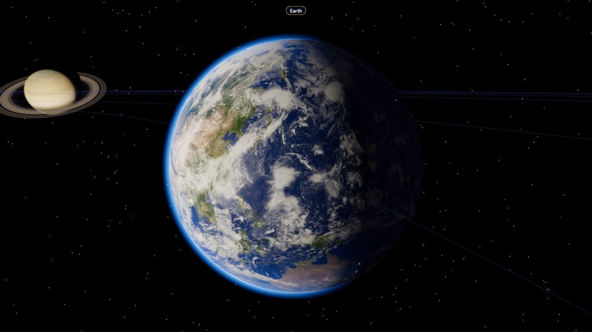
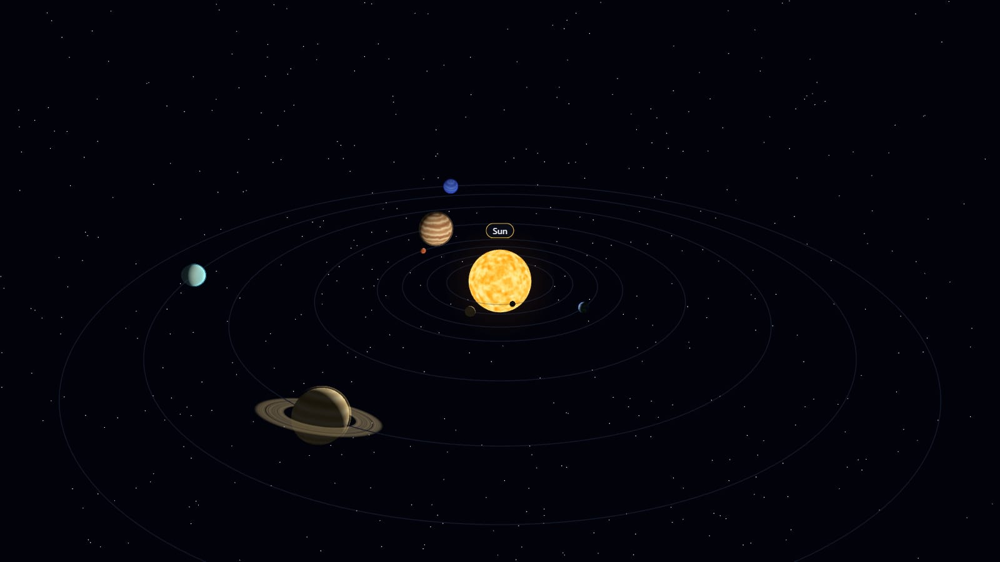
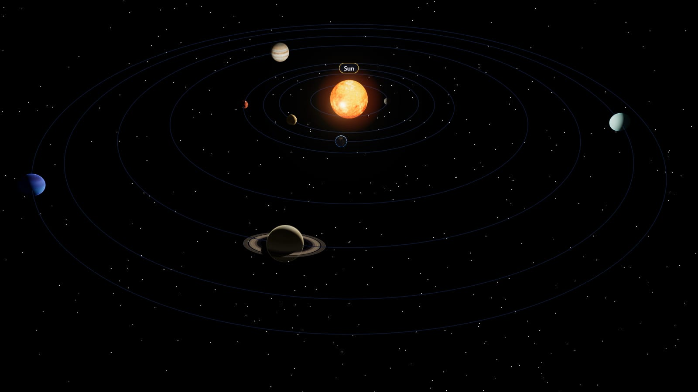
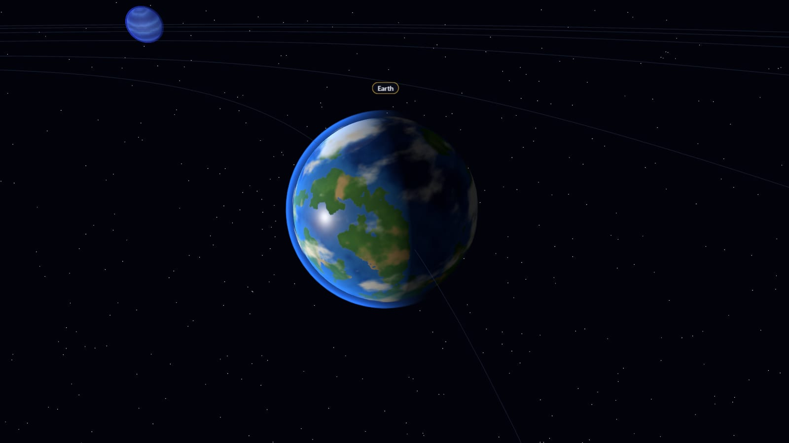
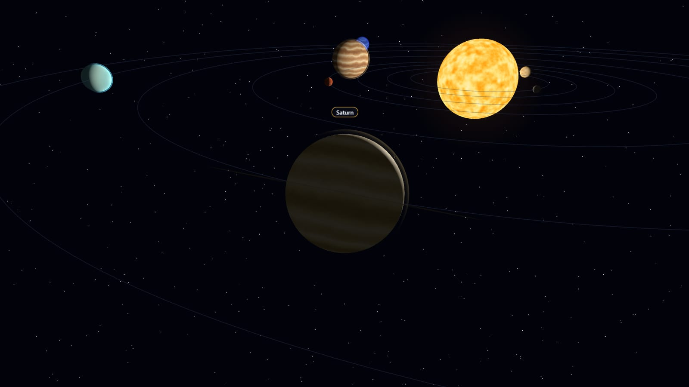
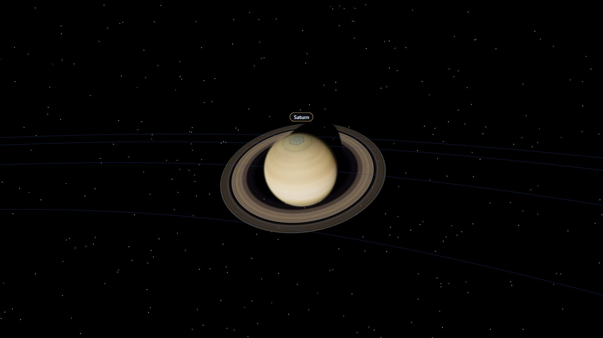

# 🪐 Gesture Space Explorer

**English** | [日本語](README.ja.md)

A 3D Solar System you control with hand gestures in front of your webcam: rotate, zoom, fly from planet to planet, point to select, and change the speed of time. Hand tracking runs entirely on your device (MediaPipe); the scene is rendered with Three.js.



## Features

- **Hand-gesture control** — nine distinct gestures (see [Controls](#controls)), designed so one can't be mistaken for another. Only the largest hand in view is in control, so people in the background can't take over.
- **Private by design** — video never leaves the browser and nothing is stored. MediaPipe's WASM and model are self-hosted, so it also works **offline / in kiosk mode**.
- **Keyboard and mouse fallback** — everything works without a camera.
- **Realistic planets (v1.1)**
  - 2K textures for every body, switching to **4K only for the planet you're zoomed in on**. Decoding happens off the main thread and uploads are spread over frames, so loading never stalls the hand tracker.
  - Every texture change **cross-fades** in the shader: no pop-in.
  - Atmosphere halos (Earth blue, Mars orange, Venus yellow), Earth's drifting cloud layer, city lights on the night side and sun glints on the oceans.
  - Saturn's ring with the planet's shadow on it, and a Sun with limb darkening and bloom. ACES tone mapping throughout.
- **Readable scale** — planet sizes are compressed (diameter^0.38) and orbits are spaced on a log scale, so every planet is clearly visible from the overview while the size order stays true. Moons get their own, tighter spacing around their planet. As you zoom out, planets are drawn up to 1.8× larger (less where neighbours or Saturn's rings are close) and moons fade away, so the overview stays readable; up close everything is true size. **True scale** (`T`, or the footer button, remembered) turns this off.
- **Smooth camera** — switching planets is a 1.5 s eased fly-in to a close orbit view. With `prefers-reduced-motion`, it cuts instead.
- **Quality setting** — Auto / Low / High (and Ultra on desktop) in the footer. Auto, the default, gives capable phones High and keeps weak devices on Low, judged from their own frame rate; switching is live, without a reload or stutter.
- **Photo mode** — 🤘 (or `P`, or the 📷 button) hides the UI, plays a shutter and saves a PNG of the scene, with an optional "app + planet" watermark (`W`). On phones, a Share button opens the system share sheet.
- **Real positions, any date (v1.2)** — planets sit where they really are on the shown date (JPL orbital elements) and spin about their real axes (IAU data), so Earth's seasons and its sunlit side match the calendar. A time bar shows the date and runs time from 1 year/s backward, through stopped and real time, to 1 year/s forward; **Now** jumps back to today. 🤙 + a tilt of the hand turns a time dial.
- **Moons (v1.3)** — Earth's Moon, Jupiter's Io, Europa, Ganymede and Callisto, and Saturn's Titan, at their real positions on the shown date and always facing their planet. Focus a planet, then press `M`, point at a moon or click it (or use the buttons in its info card) to fly there.
- **The real sky** — the Milky Way behind everything is NASA's star map from ESA's Gaia survey, turned so the band and the bright stars are exactly where they are in the sky (Sirius, Vega and the galactic center are checked in the tests). An occasional shooting star crosses the view (never with `prefers-reduced-motion`).
- **Pluto and Halley's Comet** — Pluto, labeled as a dwarf planet, and Halley's Comet follow their real tilted, eccentric orbits (Pluto really was inside Neptune's orbit from 1979 to 1999). The comet grows a coma and two tails inside ~4 AU: a straight blue ion tail pointing exactly away from the Sun, and a curved dust tail. Halley is far out now, so its card has a **Next visit** button that jumps to July 2061 at a day per second. The overview frames Neptune's orbit; zoom out to see Pluto's and Halley's.
- **Asteroid belt and Kuiper belt** — thousands of rocks between Mars and Jupiter (6,000 on High, 1,500 on Low), with the Kirkwood gaps that Jupiter's pull keeps empty, each on its own Kepler orbit so the inner ones overtake the outer ones; a faint Kuiper belt just beyond Neptune.
- **Your weight on other worlds** — enter your weight (⚖️ or `G`) to see what a scale would read on every body, from Mercury to the Sun (NASA surface gravity). A planet's info card shows your weight there and how long sunlight takes to reach it on the shown date.
- **Space bases and rocket trips (v2.0)** — five bases on real sites: Cape Launch Center (Earth), Tranquility Base (the Moon), Jezero Dome (Mars), Conamara Ice Station (Europa) and Kraken Shore (Titan), low-poly models built in code that turn with their world. `V` (or **Visit** on a card) flies down to one. Pick a destination (`←` `→`, point at a world, or the list), then launch: `Enter`, the 🚀 button, or count down with your fingers, 3 → 2 → 1. The rocket arcs between the worlds with a chase camera and warp streaks (`Enter` skips), then **you land it**: steer onto the pad with your palm, the mouse or the arrow keys. Heavier worlds come down faster and gustier; **auto-land** (`Enter` during a landing, or `A` to always land) is there for anyone who'd rather watch. A mission HUD shows fuel, the real distance left, the ETA and a mini-map, and a **passport** (`J`) collects a dated stamp for every base you reach, kept on the device.
- **Jezero, the showcase base (v2.1)** — Mars' base is now a small working outpost: three inflatable habitats joined by tunnels, a glowing greenhouse, a solar field that tracks the Sun, a rover garage, a comms antenna, two rovers on their rounds and astronauts walking between modules, standing on curved ground that blends into the planet. Its day is real: local solar time, sunrise and sunset from the ephemeris, windows lighting up at dusk. The **horizon view** (`O`, or 🌄) puts you on the ground: a butterscotch sky by day, Mars' blue sunset, and at night the real stars with Phobos (in its phase), Deimos and Earth as a bright star, all at their real positions. It's built only while Mars is in focus and freed when you leave.
- **A rocket worth watching (v2.2)** — a two-stage launcher with a crew capsule, built and painted in code. The booster separates partway out (the camera looks back as it tumbles away), and the upper stage lands on its own legs. Flames take the colour of the air, and engines kick up dust from the pad — rust on Mars, none on the Moon.
- **Jezero in real light (v2.3)** — on High and Ultra the base has its own Sun from its real sky, with shadows, sky reflections, and materials made in code (fabric, ribbed metal, solar cells, dust on the windward side). **🌅 Golden hour** in the base card jumps to the next sunset and puts you on the ground for the long shadows.
- **AstroLife 2126 (v2.6, experimental: `?flags=astrolife`)** — a fictional space-travel app around the explorer. Read about four destinations, book Cape → Jezero (nickname, departure, cabin), check in for a boarding pass whose QR code is a souvenir link, then fly it: the explorer opens at the spaceport on the departure date, taken from the next real Earth–Mars launch window (March 2127), and landing at Jezero earns the journey's stamp in the passport and a postcard to save or share. Fares, liners and the 9-day crossing are fiction, and say so. Everything stays on the device: no server, and the souvenir link carries the pass after the `#`, which browsers never send. The camera waits until the explorer opens. Without the flag, none of it is downloaded.
- **Multilingual** — the in-app UI and planet facts are available in **English, Burmese and Japanese** (press `L` to cycle). This README is available in English and Japanese.
- **Tested** — 386 Vitest tests, including gesture recognition replayed from real MediaPipe recordings, planet positions checked against real events (equinoxes, oppositions, perihelion), moons, Pluto and Halley checked against JPL Horizons, bright stars on the sky map, the camera's fly-in and framing, scale invariants, and a check that every texture file a planet can request actually ships.

## Before / After (v1.0 → v1.1)

| | v1.0 | v1.1 |
|---|---|---|
| Overview |  |  |
| Earth |  |  |
| Saturn |  |  |

v1.0 painted every texture procedurally at up to 768×384. v1.1 uses image textures, physically based lighting with tone mapping, and the effects above. Screenshots were taken at 1600×900 with the HUD hidden; orbit positions were random on each load (since v1.2 they follow the date).

## Controls

| Gesture | Action |
|---|---|
| ✋ Open palm, move it | Rotate the camera |
| ✌️ Hold a V for ~0.5 s | Next planet |
| ✌️ Swipe the V left / right | Previous / next planet (one V = one switch) |
| 🤏 Pinch and move up / down | Zoom in / out |
| ☝️ Point at a planet and hold ~1 s | Select it and show its facts (also a moon of the planet you're on) |
| ✊ Hold a fist for ~0.5 s | Pause / resume time |
| 🤏🤏 Pinch with both hands, then spread / close them | Speed time up / slow it down |
| 🤘 Index and pinky up, hold ~0.8 s | Take a photo |
| 🤙 Thumb and pinky out, hold still, then tilt left / right | Time dial: tilt right = faster forward, left = slower, then backward (either hand) |
| At a base: 3, then 2, then 1 fingers (index side, pinky down) | Launch countdown |
| While landing: move your hand | Steer the rocket onto the pad |

Every gesture uses a **different hand pose**; speed alone never decides what a gesture means:

- ✋ An open palm only ever rotates, however fast it moves; it never switches planets.
- ✌️ The V pose never rotates. A swipe needs direction, a minimum distance (relative to palm size) and speed, followed by a cooldown.
- ☝️ Pointing and ✌️ V are told apart by whether the middle finger is extended.
- 🤙 The time dial only engages once the pose has been held still for ~0.3 s, so forming it doesn't change the speed. While the dial is active, and for 0.5 s after, 🤘 can't take a photo, so a 🤙 with the thumb briefly lost never becomes a 🤘. Tilt is measured so that "right = faster" feels the same with either hand.

**Keyboard and mouse:** `←` `→` switch planets (then Pluto and Halley's Comet) · `↑` `↓` or the wheel zoom · drag to rotate · `Enter` select · `Esc` close · `Space` pause · `[` `]` time speed · `B` reverse time · `N` back to now · `M` the focused planet's moons, one by one · click a planet or moon to go there · `P` photo · `W` watermark on/off · `T` true scale (turns off the overview boost) · `G` weight panel · `V` visit the focused world's base (there, `←` `→` pick a destination and `Enter` launches; while landing, the arrows steer and `Enter` auto-lands) · `O` horizon view at Jezero (drag to look around) · `A` auto-land always · `J` passport · `L` language (English → Burmese → Japanese) · `D` debug overlay · `F` FPS counter (dev builds, or with `?debug`). The time bar has a speed slider (center = stopped), **Now** and pause buttons, for mouse and touch.

**Links (v2.4):** the address bar follows what's on screen, so copying it shares the view. A link can name a body (`?body=saturn`), a base (`?base=jezero`, with `&view=horizon` to stand on the ground), a moment (`&date=2061-07-28`, or `&date=2024-04-08T18:18Z`; it opens paused there) and a language (`&lang=ja`). Anything a link gets wrong is ignored.

**First visit (`?reset`, for user tests):** opening the app with `?reset` (for example `?reset&base=jezero`) forgets everything it saved on this device: settings, quality and what Auto learned, the passport, the weight, Build layouts. So the next tester starts as a first-time visitor. Nothing is sent anywhere and no message is shown; `reset` then drops out of the address, so a reload keeps the tester's progress. Camera permission belongs to the browser: reset it in the site settings, or use a private window.

## Quick start

Requirements: Node.js **20.19+** (or 22 LTS) and a webcam.

```bash
git clone <repo-url> hand-gesture
cd hand-gesture
npm ci            # postinstall copies the MediaPipe WASM + model into public/
npm run dev       # http://localhost:5173
```

| Command | What it does |
|---|---|
| `npm run dev` | Dev server |
| `npm run build` | Production build (`dist/`) |
| `npm run preview` | Serve the build locally |
| `npm test` | Vitest |
| `npm run typecheck` | TypeScript check |
| `npm run textures:build` | Rebuild `public/textures/` from the source images (see [Textures](#textures)) |

**Debug mode:** `?debug=1` or `D` shows render and detection FPS, detection time, tracker state, the recognized gesture, a landmark overlay, and a live config panel (lil-gui) for tuning thresholds, exposure and bloom. In debug mode, `R` starts and stops a **landmark recording** that downloads as JSON; drop it into `tests/fixtures/` to use it as a replay test.

## Quality settings

| | Low | High |
|---|---|---|
| Textures | 1K, 2K up close | 2K, 4K up close |
| Bloom | off | on |
| Pixel ratio | 1 | up to 2 |
| Where Auto starts | phones and tablets | desktop |

**Auto** (v2.4, the default) picks Low or High for your device from its frame rate: phones start on Low and try High when there's headroom, keeping it unless more than about 5% of frames come late for the screen's refresh rate; High is watched the same way everywhere. It switches only in the overview, a body, or a base at rest, remembers what it learned on this device, and never picks Ultra. The button cycles **Auto → Low → High → Ultra** (desktop) **→ Auto**; a fixed choice stays fixed.

**Ultra** (v2.2, desktop only, chosen with the Quality button): pixel ratio up to 3 for 4K screens, 8× MSAA, sharper generated textures; it steps back to High by itself if it can't keep up.

In every tier, the render resolution also follows the frame rate (v2.4): down to 60% of the tier's pixel ratio when frames are slow, never below 1× on desktop, with no texture or shader changes. `?debug` shows both.

Your choice is remembered, and switching takes effect immediately, without a reload.

## Performance

Measured on a Windows 11 laptop with an RTX 4060 Laptop GPU (Chrome, ANGLE/D3D11), with hand tracking running on the GPU from a synthetic camera feed:

| | Result |
|---|---|
| Frame rate, High, 1600×900 and 3200×1800 | steady **144 fps** on a 144 Hz display; p99 frame time 7.1 ms |
| GPU time per frame, High | **3.8–4.8 ms** median, ≤ 6.2 ms p95 (a 60 fps frame allows 16.7 ms) |
| GPU time per frame, Low | **0.5–1.0 ms** median |
| Worst frame while a 4K set streams in | **69 ms → 14 ms** |
| Worst frame on the first Low → High switch | **33–150 ms → 17–18 ms** (production build, emulated iPhone, 60 Hz display) |

GPU time is measured with WebGL timer queries (`EXT_disjoint_timer_query_webgl2`) around each frame.

#### What v2.3 costs (the base's own Sun, shadows and materials)

| View (CPU / GPU, ms) | v2.2 High | v2.3 High | v2.2 Low | v2.3 Low |
|---|---|---|---|---|
| BaseView | 2.5–2.6 / 2.5–2.6 | 4.0–4.5 / 3.3–3.5 | 2.5–2.7 / 1.0–1.5 | 2.6–2.7 / 0.9–1.8 |
| Horizon view | 2.4–2.5 / 2.5–2.7 | 3.1–4.1 / 2.8–3.4 | 2.2–2.6 / 0.5–0.7 | 2.2–2.3 / 0.6–1.4 |
| Landing | 2.9–3.0 / 2.7–2.9 | 4.1–4.3 / 3.7–4.1 | 2.4–2.6 / 1.3–1.4 | 2.6–3.5 / 0.7–2.1 |

High adds 0.7–1.2 ms of GPU and about 1.5 ms of CPU at the base; Low is unchanged (it has no second pass). Shadows and reflections are redrawn only when the Sun, the rocket or the layout changes.

#### What v2.1 costs (the Jezero showcase)

BaseView at Jezero in daylight, 1600×900, RTX 4060 laptop, headless Chrome, each version measured alone (median of three `?debug` readings):

| View | v2.0.2 CPU / GPU | v2.1 CPU / GPU |
|---|---|---|
| BaseView, High | 2.1–2.2 / 4.1–4.2 ms | 2.0 / 1.8–2.2 ms |
| BaseView, Low | 1.8–1.9 / 2.5–3.4 ms | 1.8–1.9 / 0.9–1.6 ms |
| Horizon view, High (new) | — | 2.3 / 3.9–4.2 ms |
| Horizon view, Low (new) | — | 1.9 / 0.6–1.0 ms |

GPU time is *lower* in v2.1, but not because the showcase is free: v2.1 frames BaseView closer, so less of Mars' (expensive) surface fills the screen. The showcase itself adds 15 meshes and 4.8k triangles on High (14 and 3.0k on Low), the horizon sky 5 draw calls, and its animation about 0.01 ms of CPU per frame; none of it exists outside Mars' focus.

#### What v1.3 costs (moons, belts, Pluto, the comet, the sky)

Same laptop, production builds of v1.2 and v1.3 side by side, read from the `?debug` CPU/GPU readout: mean GPU time per frame over a second, median of six readings, two runs each. Keyboard mode (no hand tracking), so these are lower than the table above. Viewport 1600×900 at a device pixel ratio of 2: High renders 3200×1800, Low 1600×900.

| View | High, before → after | Low, before → after |
|---|---|---|
| Overview | 2.8 → 3.5 ms | 1.3 → 1.2 ms |
| Earth up close (4K on High, 2K on Low) | 3.5 → 3.9 ms | 1.6 → 1.9 ms |
| Jupiter (now with its moons) | 2.7 → 3.2 ms | 0.9 → 1.3 ms |
| Saturn (now with Titan) | 2.6 → 3.1 ms | 1.2 → 1.0 ms |
| Zoomed out to the Kuiper belt and Pluto | — → 3.3 ms | |
| Among the asteroids | — → 3.0 ms | |
| Halley's tails at perihelion | — → 3.9 ms | — → 2.1 ms |

- **High: +0.4 to +0.7 ms per frame**, from the sky, the belts and the moons together (not measured separately). At this load the GPU still finishes a frame in under a quarter of a 60 fps budget.
- **Low: no measurable change.** At ~1 ms the readings move by ±0.4 ms between runs, more than the differences.
- **CPU per frame:** 1.2–1.5 ms before, 1.4–1.8 ms after. The rocks move in the vertex shader, so they cost no CPU; the extra is the moons, the comet and the sky.
- **Memory:** the sky is 32 MB on High and 8 MB on Low. Moon textures load only once their planet is visited.

### How it stays fast

- **4K only where it's visible.** Every planet loads 2K (1K on Low). Only the planet you're focused on switches to 4K (2K on Low), and only once it's too large on screen for the base texture: a 2K map has about 650 texels across the visible disk, so the switch happens at about 650 device pixels. Hysteresis and a short delay keep a quick zoom from triggering a download. When you zoom out or move on, the 4K textures are released with `dispose()`. A 4K texture takes about 45 MB of GPU memory, so the rest of the system never pays for it.
- **No stalls while textures load (69 ms → 14 ms).** Images are decoded off the main thread with `createImageBitmap`, then uploaded to the GPU in about 2 MB slices, one per frame, instead of one 32 MB upload. Flipping images while decoding (`imageOrientation: 'flipY'`) turned out to stall frames in Chrome, so textures are stored top row first and the sphere's UVs are flipped instead. This matters because the hand tracker runs on the same thread: a long frame means a late gesture.
- **Cross-fades without shader recompiles.** Every material slot holds a texture from the start (a 1×1 placeholder), and the shader blends each slot with a twin (`mix(map, mapNext, fade)`), so swapping textures never changes a shader.
- **Saturn's ring shadow is computed in the shader.** For each point on the ring, the fragment shader checks whether the ray toward the Sun hits the planet's sphere. A shadow map for the Sun, a point light, would need six extra render passes every frame.
- **Less geometry where nobody can tell.** Spheres use 128 segments for the focused planet and for planets that are large on screen, and 64 or 32 for distant ones.
- **Bloom only on High.** Its buffers are allocated only while it's on, so Low, the phone default, doesn't spend memory on them.
- **No stutter when switching quality.** While the browser is idle after startup, the shaders the other quality needs are compiled in the background (`renderer.compileAsync`), including bloom's own. Production builds also turn off three.js's shader error checks, which cost a synchronous GPU round trip per shader on first use.

### Measure on your device

Open the app with `?debug` (for example `https://<your-app>/?debug`): an FPS counter appears in the top-right corner. Tap it to switch between frames per second, milliseconds per frame and memory. Under it, **CPU** and **GPU** show how long each frame takes, as the mean and 95th percentile over the last second: CPU is the app's own work per frame (scene update, render commands, HUD), GPU is the time the graphics card spends drawing it. GPU time needs WebGL timer queries, which desktop Chrome and Edge have; where they're missing (Safari, Firefox, many phones) it shows *n/a*, and CPU time still tells devices apart. Compare Low and High with the Quality button in the footer. `?debug` also turns on the debug overlay described in [Quick start](#quick-start).

### Known limitations

- **Older Safari (< 17) and Firefox (< 98)** don't support the image-decoding options used here, so they decode textures on the main thread. Loading, and especially the switch to 4K, can stutter there. Current versions aren't affected.
- **Phones:** Low quality is designed for mid-range phones, but it **hasn't been measured on a real device** yet. That's what `?debug` is for.
- **Halley's Comet is only accurate around its 1986 and 2061 visits.** Its orbit here is a two-body ellipse tuned to pass both of those perihelia, but Jupiter and Saturn stretch the real orbit differently each time round, so other returns drift by months: 1910's comes ~4 months late, and the return after 2061 shows as January 2137 (really March 2134).
- **Pluto's southern hemisphere is a plain cap.** New Horizons couldn't image it in 2015 (it was in darkness), so the map fills it with the average of the nearest imaged latitude.
- **Bases (v2.0) are stylized.** Bases and rockets are drawn far larger than real, trips take seconds and follow a pretty arc, not a real transfer orbit, and fuel is a game number. Distances on the HUD are real (from the ephemeris).
- **Time runs at real speed at a base**, so it doesn't spin out from under you; the speed you had comes back when you leave.
- **The base panel on phones** doesn't yet move the camera out of its way like the info sheet does, so on small screens it can cover part of the base.
- **Burmese strings for v2.0 need a native review** (see [docs/i18n-review-my.md](docs/i18n-review-my.md)).
- **Phobos and Deimos are in Jezero's sky only** (horizon view), not bodies you can visit; `M` on Mars still says there are no moons to visit. Their positions are fitted to JPL Horizons for 2020–2035 (within 3.2° and 1.9°); outside those years Phobos is marked "approximate". In the sky they're drawn 6× their real size unless True scale is on.
- **The horizon view is a stylized trick.** At this app's scale Mars is only a few base-widths across, so the view swaps the planet's curve for a flat plain under a sky dome.
- **The showcase is Jezero only.** The other four bases keep their v2.0 buildings (the kit is built to be reused).

## How it works

```
src/
  main.ts             wiring + render loop
  intents.ts          Intent type + bus: every input becomes an Intent
  config.ts           every tunable number (live-editable in debug mode)
  quality.ts          Low / High profiles, mobile detection
  data/               bodies.ts (planet data: orbits, rotation axes, facts in English/Burmese/Japanese),
                      ephemeris.ts (positions and axes for a date), scale.ts (size and distance compression), weight.ts
  sim/clock.ts        the simulated date and its speed
  input/keyboard.ts   keyboard + mouse → Intent
  gestures/           perception (landmarks → pose) + engine (→ Intent); pure, no Three.js
  tracking/           camera, MediaPipe hand tracker, One Euro filter
  scene/              solarSystem, cameraRig (fly-in, framing), picking, postprocessing (bloom)
  planets/            how a body is built: materials, atmosphere, ring, Sun,
                      surface (texture tiers + cross-fade), textureLoader, procedural fallback
  ui/                 HUD, gesture HUD, labels, debug overlay, recorder, i18n
scripts/              copy-mediapipe-assets.mjs, build-textures.mjs
public/textures/      1k / 2k / 4k planet textures (~11 MB in total)
tests/                Vitest
```

- **Input never touches the scene directly.** Keyboard, mouse and gestures all emit `Intent`s, and the scene reacts only to those. The gesture code is pure TypeScript that is tested without a browser.
- **Textures** stream in after the first frame: until they arrive, each body shows its base color. If the images can't be loaded, the original procedural textures are used. How the streaming avoids stalls is described under [Performance](#performance).
- **Effects** are small patches to Three.js's built-in physical materials (`onBeforeCompile`), plus one custom shader for the atmosphere halo.
- **Time:** each planet's heliocentric longitude comes from JPL's Keplerian elements, solved for the shown date. Distances stay on the readable log scale, so only the direction is real. Spin axes and the prime meridian come from the IAU rotation model. At high speeds the spin shown is capped at 36°/s so planets don't strobe; it catches up with the exact angle when time slows down.
- **Scale:** radius ∝ diameter^0.38 (Earth = 2 units). Gaps between planets follow ln(distance in AU), with a clearance floor so neighbours never touch when they line up — including their rings and moons. That floor moves Earth and Mars out slightly (for the Moon) and Saturn, Uranus and Neptune more (for Jupiter's moons, Saturn's rings and Titan). The overview framing is solved numerically against the real camera projection, so every planet's orbit fits.
- **Sky:** a sphere around the camera, drawn first and without depth, whose shader turns each pixel's direction into right ascension and declination and looks it up on the star map. That avoids `scene.background`, which would turn the 4K map into a ~130 MB cube map; the map itself is 32 MB on High (4K) and 8 MB on Low (2K), with no mipmaps since it's never shown smaller than it is. It's the one texture that's always in view, so it's the one exception to 4K only up close. The map is built from NASA's HDR (OpenEXR) file with three.js' EXR decoder in `npm run textures:build`.
- **Pluto and the comet** are placed where they really are in 3D, at their real distance mapped through the planets' log scale (`sceneDistance`, which passes exactly through every planet's orbit). Pluto uses JPL's elements like the planets (within 0.05° of Horizons). Halley's orbit is a two-body ellipse from JPL's Small-Body Database with its period tuned to the 1986 and 2061 perihelia (within ~3° of Horizons in between); other returns drift by months. Its tails are camera-facing ribbons rebuilt each frame, with additive blending.
- **Belts:** each belt is one `InstancedMesh` (one draw call). The instance matrices only hold each rock's size and tumble; its position on its orbit is computed in the vertex shader from the date, so moving thousands of rocks costs no CPU time, and Low quality simply draws fewer of them. Rocks keep their real semi-major axes, spread by log distance across the clear band between Mars and Jupiter's moons.
- **Moons:** half the planets' size law, so they stay comparable (Ganymede is the largest) and smaller than any planet. Their distances are compressed separately: the first just outside the planet's rings or atmosphere, the rest log-spaced with a minimum gap, so Callisto still sits clearly farthest out. Positions come from mean longitudes fitted to JPL Horizons (1950–2100: within ~1° for the Galilean moons, 0.1° for Titan); the Moon uses the main terms of Meeus' lunar theory, so phases and eclipses fall on the right dates. At high speeds a system's moons are slowed together, keeping their 4 : 2 : 1 rhythm, and each always turns the same face to its planet.

### Textures

The textures in `public/textures/` come from [Solar System Scope](https://www.solarsystemscope.com/textures/) (CC BY 4.0), resized and converted by `scripts/build-textures.mjs` (using sharp, a dev dependency). The built files are committed, so you only need this to change them:

```bash
npm run textures:build   # downloads the sources once into .texture-sources/ (git-ignored), then builds 1K / 2K / 4K
```

## Supported browsers

| Browser | Status |
|---|---|
| Chrome / Edge (desktop) | ✅ Primary target (GPU delegate) |
| Firefox (desktop) | ✅ Works; falls back to the CPU delegate if the GPU one is unavailable |
| Safari (macOS) | ⚠️ Uses the CPU delegate automatically (its GPU delegate is unreliable) |
| iOS / Android | ⚠️ Works, but not a primary target |

The camera only works over **HTTPS** or on `localhost`.

## Deploy (Vercel)

It's a static Vite app: no server code and no environment variables.

| Setting | Value |
|---|---|
| Framework preset | **Vite** |
| Build command | `npm run build` |
| Output directory | `dist` |
| Node.js version | **22.x** |

- **Assets:** `prebuild` copies the MediaPipe WASM even if Vercel's install cache skipped `postinstall`. The copy script exits with an error if a file is missing or the model's SHA-256 doesn't match, so a broken build never deploys silently.
- **Versioning:** the WASM goes to a **versioned path** (`/mediapipe/<version>/wasm/`), so it can be cached `immutable`. The hand model isn't in the npm package, so it's committed under `assets/models/`, which means install and build need no network.
- **CI:** GitHub Actions ([`.github/workflows/ci.yml`](.github/workflows/ci.yml)) runs typecheck, tests and build on every PR.

`vercel.json` sets `Permissions-Policy: camera=(self)`, `immutable` caching for the versioned MediaPipe and model files, and one day plus stale-while-revalidate for `/textures/`, whose file names aren't versioned. COOP/COEP headers aren't needed (no `SharedArrayBuffer`). To embed the app in an iframe, use `<iframe allow="camera">`.

Every pull request gets a Vercel **preview URL**; merging to `main` deploys to production (CLI: `npx vercel`, `npx vercel --prod`).

**After deploying, check:**

- [ ] `.wasm` files are served as `application/wasm` with status 200
- [ ] `/models/*.task` doesn't 404
- [ ] `/textures/2k/earth_day.jpg` loads
- [ ] The response includes the `Permissions-Policy` header
- [ ] Denying the camera falls back to keyboard mode
- [ ] Measure load time in a private window (empty cache)

### Exhibition / kiosk (offline)

```bash
npm run build && npm run preview
```

No internet connection is needed. Open `http://localhost:4173` in Chrome's `--kiosk` mode **on the same machine**. Opening it through a LAN IP (with `--host`) isn't a secure context, so the camera won't work. To pre-approve camera access, use the `VideoCaptureAllowedUrls` enterprise policy, or `--use-fake-ui-for-media-stream` for a quick setup.

## Privacy

- Camera frames are processed in the browser and never sent to a server.
- No video, images or landmark data are stored.
- The weight you enter is kept only in this browser (`localStorage`) and never sent anywhere.
- AstroLife's bookings, passes and stamps (`?flags=astrolife`) are kept only in this browser too; its passport can delete them all. A boarding pass's souvenir link holds the nickname, avatar, flight and cabin after the `#`, so it reaches whoever you share it with, but never a server.
- The debug recorder downloads landmark numbers (not images) to your own machine, and only when you start it yourself.

## Credits & license

- Planet textures and the Moon: [Solar System Scope](https://www.solarsystemscope.com/textures/), **CC BY 4.0** (resized and converted; see `public/textures/LICENSE.txt`)
- Io, Europa, Ganymede, Callisto and Titan: global mosaics by the [USGS Astrogeology Science Center](https://astrogeology.usgs.gov) from NASA/JPL Voyager, Galileo and Cassini data, **public domain** (credit: U.S. Geological Survey; NASA/JPL)
- The sky: [NASA/Goddard Space Flight Center Scientific Visualization Studio, Deep Star Maps 2020](https://svs.gsfc.nasa.gov/4851), public domain; star data **ESA/Gaia/DPAC**
- Pluto: USGS mosaic of NASA/JHUAPL/SwRI New Horizons data, public domain. Halley's orbit: [JPL Small-Body Database](https://ssd.jpl.nasa.gov/tools/sbdb_lookup.html#/?sstr=1P)
- Moon positions: fitted to [JPL Horizons](https://ssd.jpl.nasa.gov/horizons/); the Moon from J. Meeus, *Astronomical Algorithms*, ch. 47
- [MediaPipe](https://github.com/google-ai-edge/mediapipe): Apache 2.0
- [Three.js](https://threejs.org/): MIT
- Planet facts: NASA. Surface gravity: [NASA Planetary Fact Sheet](https://nssdc.gsfc.nasa.gov/planetary/factsheet/) and [Sun Fact Sheet](https://nssdc.gsfc.nasa.gov/planetary/factsheet/sunfact.html)
- Orbits: E. M. Standish, [Keplerian Elements for Approximate Positions of the Major Planets](https://ssd.jpl.nasa.gov/planets/approx_pos.html), JPL (Table 1, valid 1800–2050)
- Rotation axes and rates: Archinal et al., *Report of the IAU Working Group on Cartographic Coordinates and Rotational Elements: 2015*, Celest. Mech. Dyn. Astr. 130:22 (2018)
- This project: [MIT](LICENSE)

See [CHANGELOG.md](CHANGELOG.md) for what changed in each version.
